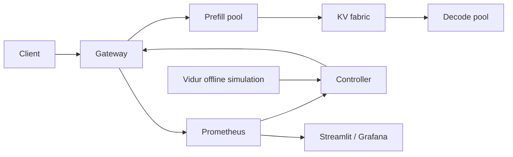

# Hyperion

Hyperion is a **disaggregated LLM-inference control-plane simulator**. It models a prefill pool, decode pool, prefix/KV fabric, gateway metrics, and a self-tuning controller without requiring a GPU or model download.

> Vidur is used for capacity/performance simulation. It is not a fake CUDA device and cannot run vLLM on a CPU-only machine.

## What works in v0.1

- OpenAI-shaped `POST /v1/chat/completions` gateway
- Separate simulated prefill and decode queues
- KV/prefix cache with hit/miss metrics
- Prometheus metrics endpoint and Grafana dashboard provisioning
- Rule-based controller which changes pool size, batching, prefix-cache mode, and speculative decoding
- Vidur scenario runner for an optional high-fidelity offline capacity study
- Streamlit live dashboard

## Quick start (no GPU)

```bash
cp .env.example .env
docker compose up --build
```

Open:

- Gateway docs: http://localhost:8000/docs
- Prometheus: http://localhost:9090
- Grafana: http://localhost:3000 (`admin` / `hyperion`)
- Next.js Control Room: http://localhost:8501

Send a request:

```bash
curl http://localhost:8000/v1/chat/completions \
  -H 'content-type: application/json' \
  -d '{"model":"simulated-llama-3-8b","messages":[{"role":"user","content":"Explain paged attention simply"}],"max_tokens":100}'
```

## Watch it self-tune

In Gateway Docs, run `POST /demo/load` using its default body. It warms one shared prefix and sends 12 concurrent long generations. The controller checks every two seconds, detects decode pressure, and increases the simulated decode-pool size. Refresh the Control Room to see `last_controller_decision` and the new topology.

The Next.js Control Room includes the same traffic-burst action as a button and explains each stage in plain language.

## Architecture



## Running Vidur (optional)

Vidur currently requires Python 3.10. Keep it separate from the regular API environment:

```bash
python3.10 -m venv .venv-vidur
source .venv-vidur/bin/activate
pip install -r requirements-vidur.txt
python -m hyperion_sim.vidur_runner --qps 6 --requests 128
```

The runner writes a reproducible command and scenario metadata under `simulator_output/`. For exact model/device profiles, use the supported Vidur model/device combinations described in its README.

## Controller policy

Every 10 seconds the controller observes queue depth, p95 TTFT, token latency, and cache hit rate.

- high prefill pressure -> add a prefill replica
- high decode pressure -> add a decode replica
- high shared-prefix traffic -> aggressive prefix cache
- stable predictable traffic -> enable speculative decoding
- idleness -> shrink pools safely

These are simulated topology changes today. Replacing `RuntimeState` with Kubernetes/vLLM/SGLang adapters is the Phase 2 production integration point.
