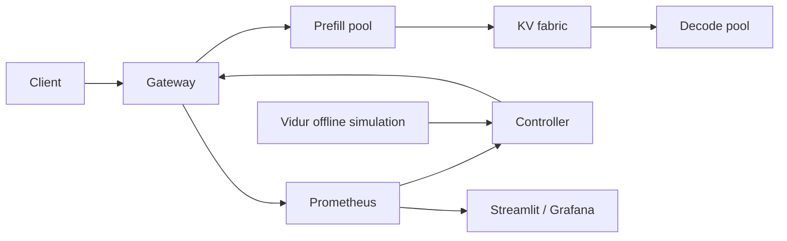

# Hyperion

Hyperion is an inference-systems learning lab with two explicitly separated modes:

- **Simulator mode (default):** models request queues, a toy prefix-cache timing model, a rule-based controller, Prometheus metrics, and offline Vidur capacity studies. It does not generate answers with an LLM.
- **Optional vLLM CPU mode:** sends chat requests to a real, small open model served by vLLM on the CPU. This can be slow and consume CPU/RAM; keep it off unless you intentionally start it.

Vidur estimates performance for a selected GPU profile. It does not create a virtual GPU or run GPU kernels. The CPU vLLM profile is real model inference, but it is not a substitute for GPU performance.

## What works in v0.1

- OpenAI-shaped `POST /v1/chat/completions` gateway
- Separate simulated prefill and decode queues
- KV/prefix cache with hit/miss metrics
- Prometheus metrics endpoint and Grafana dashboard provisioning
- Rule-based controller that changes simulated pool sizes and cache/speculation state based on queue and cache counts
- Vidur sweep optimizer that runs a bounded candidate set and ranks configurations against latency SLOs
- Pareto-style latency/efficiency charts and request-level decode CDF in the Control Room
- Next.js Control Room dashboard; a Streamlit dashboard source is also included

## Quick start (no GPU)

```bash
cp .env.example .env
docker compose up --build
```

Open:

- Gateway docs: http://localhost:8000/docs
- Prometheus: http://localhost:9090
- Grafana: http://localhost:3000 (`admin` / `hyperion`)
- Next.js Control Room: http://localhost:8501

Send a request:

```bash
curl http://localhost:8000/v1/chat/completions \
  -H 'content-type: application/json' \
  -d '{"model":"simulated-llama-3-8b","messages":[{"role":"user","content":"Explain paged attention simply"}],"max_tokens":100}'
```

## Simulated live-control demo

In Gateway Docs, run `POST /demo/load` with its default body. It warms a shared prefix and sends 12 concurrent simulated requests. The rules controller sees simulated queue pressure and may increase the simulated decode pool. This is a learning demo, not a live-model optimization.

## Optimize with Vidur

Start the default stack, then in another terminal start the optional optimizer service:

```bash
docker compose --profile vidur up -d --build vidur
```

The first build downloads and installs Vidur. Its container is limited to two CPU cores, and it simulates candidates sequentially. Open http://localhost:8501, choose a workload, scheduler, batch cap, chunk sizes, latency targets, and an editable GPU-hour price assumption. Then click **Run Vidur optimization**.

The bounded sweep compares replica counts 1, 2, and 4, plus one alternate Sarathi chunk size, using the same synthetic workload. Hyperion reads the request-level Vidur CSV results and plots TTFT p90, normalized decode-time p99, an SLO trade-off map, and a decode-time CDF. It marks the best tested candidate that passes both latency goals.

The displayed QPS / $·h score is calculated from offered QPS, replica count, and the price you entered. It is not measured throughput or a cloud price. The candidates are offline A100-profile estimates. Hyperion recommends among them; it does not apply changes to a live serving system.

The dashboard says **Vidur optimizer stopped** until the optional service is running. The optimizer button also explains how to start it if you click while it is stopped.

## Run a real model on CPU (optional)

This pulls a vLLM CPU image and downloads Qwen2.5-0.5B-Instruct the first time. It is intentionally separate from the default stack because model inference can make a CPU-only computer slow:

```bash
HYPERION_BACKEND=vllm_cpu docker compose --profile vllm-cpu up -d --build gateway dashboard vllm-cpu
```

Open the Control Room at http://localhost:8501 and use **Try Hyperion**. The model service is limited to 2 CPU cores, 1 GB of KV-cache space, a 1024-token context, and one active sequence. To stop it and return to simulation mode:

```bash
docker compose --profile vllm-cpu down
docker compose up -d gateway dashboard
```

If the model service fails to start, inspect it with `docker compose --profile vllm-cpu logs -f vllm-cpu`. This optional image targets x86-64 CPU machines; consult vLLM's CPU installation guidance for architecture-specific support.

## Architecture



## Run Vidur from the command line

The optimizer service above is the recommended way to run the dashboard sweep. To run one manually while the Vidur profile is up:

```bash
docker compose exec vidur python /workspace/hyperion_sim/vidur_runner.py --qps 4 --requests 32 --replicas 2
```

Then process a run's request metrics to save its profile:

```bash
python -m hyperion_sim.vidur_results --run-dir simulator_output/<run-folder>
```

Vidur runs in a Python 3.10 container. The optimizer writes profiles and CSV metrics under `simulator_output/`; the dashboard reads from that same directory.

## Recommend a replica count

After processing each Vidur run with `hyperion_sim.vidur_results`, compare profiles for the same workload and ask the script to select the fewest replicas that meet the latency targets:

```bash
python -m hyperion_sim.recommend_replicas \
  simulator_output/<one-replica-run> \
  simulator_output/<two-replica-run> \
  simulator_output/<four-replica-run>
```

Replace those example directory names with the folders containing each run's `hyperion_profile.json`. By default, the script uses example targets of TTFT p95 <= 600 ms, E2E p95 <= 10 seconds, and scheduling-delay p95 <= 400 ms. You can set different limits with `--max-ttft-p95-ms`, `--max-e2e-p95-seconds`, and `--max-scheduling-delay-p95-ms`. These are lab settings, not production SLOs. The script rejects profiles whose workload settings do not match.

The Gateway exposes the tested run list at `GET /optimization/runs` and starts a sweep through `POST /optimization/run`. `GET /vidur-recommendation` remains available for the earlier replica-count workflow.

## What the current version simulates

The Gateway returns a generated placeholder response; it does not call a language model. Its prefill and decode stages are logical queues in one Python process, and its prefix cache is an in-memory timing model. Prometheus records simulated request counters, latency histograms, cache events, and queue values. There is no physical GPU utilization metric.

The controller polls every two seconds by default. It adds a simulated prefill or decode replica when the corresponding active queue exceeds its current capacity. When the cache-entry count exceeds 20, it sets the aggressive-cache and speculative-decoding flags. Those flags describe simulator state; they do not change vLLM kernels or model execution. The Vidur optimizer compares scenarios and surfaces a recommended candidate, but it does not apply that configuration to a live serving cluster.

## Current limits and next engineering steps

The optional vLLM CPU profile provides genuine model inference through one vLLM server. The regular Gateway's prefill/decode queues, in-memory cache, and controller remain simulator components. The CPU vLLM path currently does not stream tokens or export vLLM metrics into Hyperion's local Prometheus scrape.

Still required for the full GPU inference OS vision:

- Real separate Prefill and Decode workers that share/transmit the model's actual KV tensors. Two independent model servers alone do not achieve disaggregated inference.
- A compatible KV connector such as NIXL, validated against the chosen vLLM version and hardware. vLLM documents disaggregated prefill as experimental; it needs coordinated instances and a functioning connector.
- Real GPU deployment and GPU telemetry. Vidur outputs are estimates, not measured GPU telemetry.
- Actual speculative decoding and quantization configurations validated against a model/backend. Current simulator flags do not activate those features.
- A controller that safely applies real serving changes and measures their effect. The current Vidur optimizer recommends among offline simulations; the rules controller operates on simulated topology.

These are not represented as complete. Start with the CPU model request, then proceed to the real serving integration in small, hardware-appropriate steps.


## Autonomous episodic controller

Start gateway/dashboard and the Vidur service, then use **Start autonomous session** on the dashboard. Default traffic is 4 → 8 → 4 QPS, with 32 requests per independent simulation. The controller observes the active replica count, explores 1/2/4 replicas, minimizes normalized p95 TTFT/E2E target violations and then replica count, applies its choice to a fresh validation episode, and accepts or rolls back. Validation errors also restore the previous configuration.

Evidence persists in simulator_output/autonomy_memory.json. For identical traffic and request counts, previously inferior candidates are skipped; promising candidates are still measured again. This is tabular evidence reuse, not neural policy training. Stop takes effect after the current subprocess completes (up to its 30-minute timeout). Jobs are serialized with manual sweeps. Sessions are bounded and do not restart automatically after service restart.

GET localhost:8101/autonomy exposes state/events. POST /autonomy/start accepts traffic, cycles, ttft_ms, e2e_seconds, requests and interval_seconds. POST /autonomy/stop requests a stop.

These are independent Vidur episodes. Queue/KV state and reconfiguration overhead do not carry between them. Applied replica counts govern subsequent simulation experiments; they do not reconfigure the separate toy gateway runtime or real GPUs. This implements autonomous episodic experimentation, validation and rollback, not continuous live-cluster control. The initial dashboard shows p95 TTFT observations and an event timeline; it uses fixed default targets of 600 ms TTFT and 10 s E2E.

Validation performed: frontend production build, Python syntax checks, and deterministic evaluator checks for accept, regression rollback and evidence reload. A full Vidur session still needs execution in the configured Docker environment.
