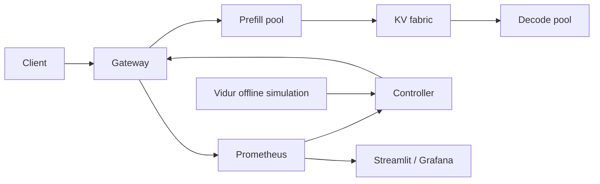

# Hyperion

Hyperion is a **CPU-only simulator for an LLM-inference control plane**. It models logical prefill and decode queues, a small in-memory prefix-cache model, request metrics, a rule-based controller, and offline Vidur capacity studies. It does not run an LLM.

> Vidur is used for capacity/performance simulation. It is not a fake CUDA device and cannot run vLLM on a CPU-only machine.

## What works in v0.1

- OpenAI-shaped `POST /v1/chat/completions` gateway
- Separate simulated prefill and decode queues
- KV/prefix cache with hit/miss metrics
- Prometheus metrics endpoint and Grafana dashboard provisioning
- Rule-based controller that changes simulated pool sizes and cache/speculation state based on queue and cache counts
- Vidur scenario runner for offline GPU-profile capacity studies
- Next.js Control Room dashboard; a Streamlit dashboard source is also included

## Quick start (no GPU)

```bash
cp .env.example .env
docker compose up --build
```

Open:

- Gateway docs: http://localhost:8000/docs
- Prometheus: http://localhost:9090
- Grafana: http://localhost:3000 (`admin` / `hyperion`)
- Next.js Control Room: http://localhost:8501

Send a request:

```bash
curl http://localhost:8000/v1/chat/completions \
  -H 'content-type: application/json' \
  -d '{"model":"simulated-llama-3-8b","messages":[{"role":"user","content":"Explain paged attention simply"}],"max_tokens":100}'
```

## Watch it self-tune

In Gateway Docs, run `POST /demo/load` using its default body. It warms one shared prefix and sends 12 concurrent long generations. The controller checks every two seconds, detects decode pressure, and increases the simulated decode-pool size. Refresh the Control Room to see `last_controller_decision` and the new topology.

The Next.js Control Room includes the same traffic-burst action as a button and explains each stage in plain language.

## Architecture



## Running Vidur (optional)

Vidur runs in its own Python 3.10 Docker image, so it cannot conflict with your normal Python installation:

```bash
docker compose --profile vidur run --rm vidur --qps 4 --requests 128
```

The first run downloads the Vidur image dependencies. The runner writes a reproducible command and scenario metadata under `simulator_output/`. For exact model/device profiles, use the supported Vidur model/device combinations described in its README.

## Recommend a replica count

After processing each Vidur run with `hyperion_sim.vidur_results`, compare profiles for the same workload and ask the script to select the fewest replicas that meet the latency targets:

```bash
python -m hyperion_sim.recommend_replicas \
  simulator_output/<one-replica-run> \
  simulator_output/<two-replica-run> \
  simulator_output/<four-replica-run>
```

Replace those example directory names with the folders containing each run's `hyperion_profile.json`. By default, the script uses example targets of TTFT p95 <= 600 ms, E2E p95 <= 10 seconds, and scheduling-delay p95 <= 400 ms. You can set different limits with `--max-ttft-p95-ms`, `--max-e2e-p95-seconds`, and `--max-scheduling-delay-p95-ms`. These are lab settings, not production SLOs. The script rejects profiles whose workload settings do not match.

The same recommendation is available from the Gateway at `GET /vidur-recommendation`. The Next.js Control Room lets you edit the latency targets and displays the selected replica count and each tested profile. The dashboard remains usable when Vidur profiles are absent; those panels show a message until profiles are generated.

## What the current version simulates

The Gateway returns a generated placeholder response; it does not call a language model. Its prefill and decode stages are logical queues in one Python process, and its prefix cache is an in-memory timing model. Prometheus records simulated request counters, latency histograms, cache events, and queue values. There is no physical GPU utilization metric.

The controller polls every two seconds by default. It adds a simulated prefill or decode replica when the corresponding active queue exceeds its current capacity. When the cache-entry count exceeds 20, it sets the aggressive-cache and speculative-decoding flags. Those flags describe simulator state; they do not change vLLM kernels or model execution. This version does not apply Vidur's offline recommendation to the running topology.

## Not implemented yet

- Real vLLM or SGLang model serving, including token streaming
- Separate Prefill and Decode worker processes that transfer real KV tensors
- Redis, NIXL, or Mooncake as a distributed KV-transfer fabric
- Physical GPU metrics, model quantization, and working speculative decoding
- An LLM-based controller or production orchestration that starts and stops real workers

Vidur estimates capacity from GPU profiles while running on the CPU. It is not a fake CUDA GPU and cannot make a CPU run vLLM as though an NVIDIA GPU were present. These boundaries are deliberate so simulated results are not mistaken for live inference measurements.
